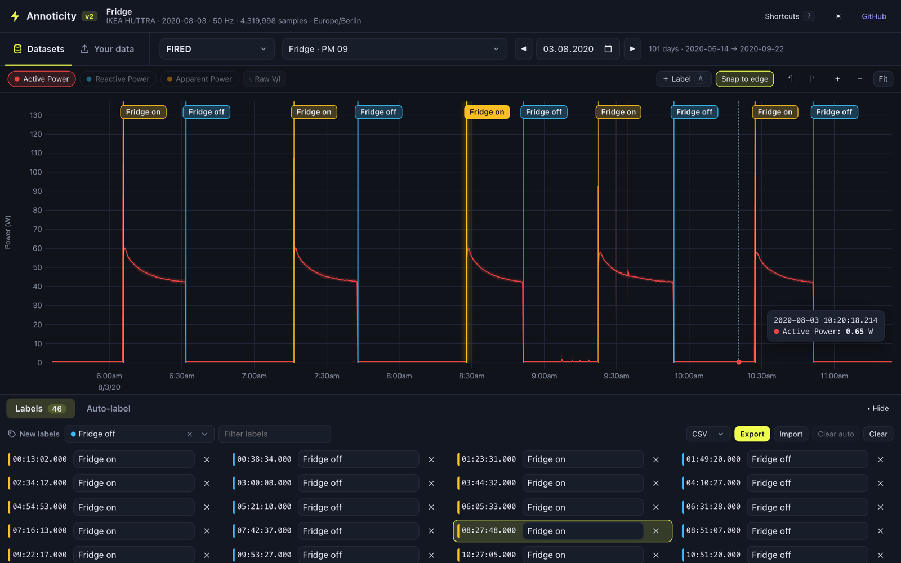
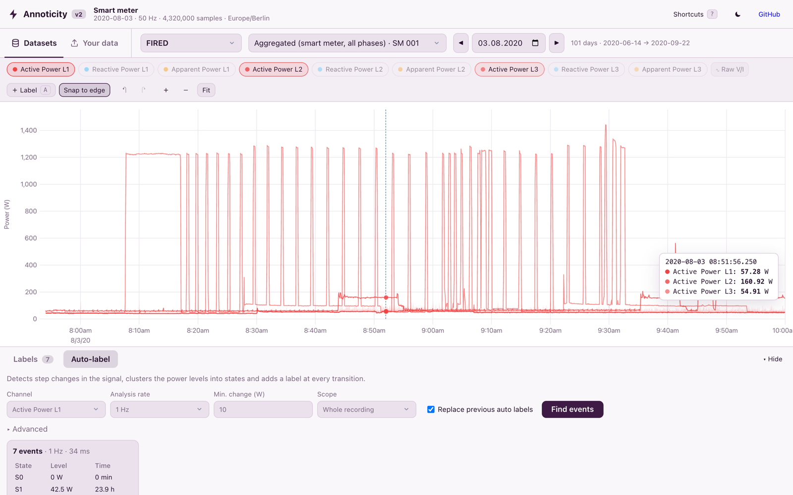
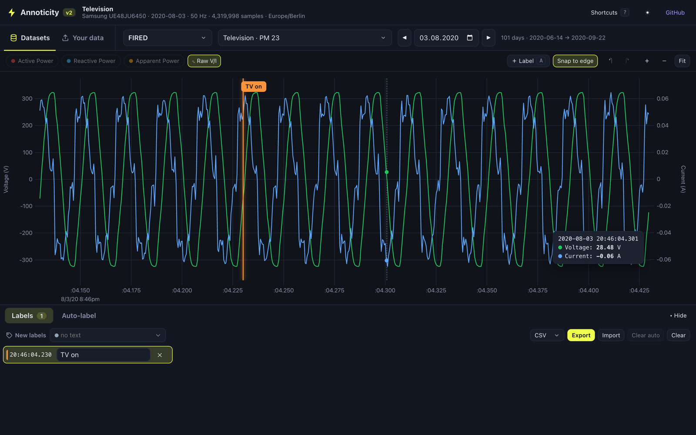

# Annoticity v2

Browse and label electricity datasets. Version 2 is a rewrite with a **Svelte** frontend and a **Node.js** backend.
The original Django version lives on the `annoticitiy_v1` branch.



**[Open Annoticity online](https://annoticity.voelkerb.com/)** ·
[v2.0.0 offline bundle](https://github.com/voelkerb/annoticity/releases/tag/v2.0.0) (needs Node 20+)
· [v1.0.0 source](https://github.com/voelkerb/annoticity/releases/tag/v1.0.0)

| Auto-labeling (light theme) | Raw voltage and current | BLOND mains, three phases |
| --- | --- | --- |
|  |  |  |

- **Datasets**: pick a dataset, a meter and a day. The server fetches or reads the recording and caches it decoded.
  - **FIRED**: 50 Hz summary data, raw 2 kHz V/I (university server).
  - **BLOND** (BLOND-50 and BLOND-250): 1 Hz summaries per socket and for the mains, raw V/I up to 12.5 kHz (TUM's public FTP server).
  - **REDD**, **UK-DALE**, **ECO**: read from a local copy (see Configuration).
- **Your own data**: drop a CSV (header + time column + numeric columns, parsed in the browser) or a FIRED-style MKV file.
- Wide plot with min/max envelopes (short spikes stay visible). Zooming and panning run locally on the full-resolution data;
  raw V/I at 30 s or less (FIRED, BLOND).
- Y axis fits the visible data; scroll or drag on the axis (or Alt + scroll on the plot) to zoom and pan it, "Auto Y" or double-click to fit again.
- Labels: click to add, drag, rename, snap to edge, undo/redo, import/export (CSV, SRT, ASS, JSON).
- Auto-labeling: step detection with refined edges and state clustering, running in a Web Worker.

## Architecture

The browser does almost all the work. It holds a loaded day as `Float32Array`s and handles:

- downsampling, using a block min/max/sum pyramid so even full-day views avoid scanning every sample
- auto-labeling
- CSV parsing
- labels

The server (`server/`) only does what a browser cannot:

- download FIRED files (Basic auth, no CORS) and BLOND files (FTP, HDF5)
- read large local dataset folders (REDD, UK-DALE, ECO) and put irregular samples on a regular grid
- decode WavPack/Matroska with FFmpeg

Each dataset is a provider in `server/src/datasets/`.

It returns the decoded channels in a small binary format: a JSON header followed by float32 channels (see `server/src/binary.js`).

## Run

Requires Node 20+ and `ffmpeg`/`ffprobe` on the server machine.

```bash
npm run setup   # installs root, server and web dependencies
npm run dev     # API on :8787, UI on http://localhost:5173
```

Production: `npm run build && npm start` serves the built UI and the API on http://localhost:8787.

`npm test` runs the server and engine tests, `npm run check` type-checks the frontend.

Offline bundle: `scripts/package-offline.sh v2.x.y` writes `release/annoticity-v2.x.y-offline.zip` (built UI and server
with Node dependencies; needs Node 20+, plus ffmpeg for FIRED/MKV and Python 3, PyTables and NumPy for UK-DALE HDF5).
Ready-made bundles are attached to the GitHub releases.

## Configuration (environment)

Set these in `server/.env` or the root `.env` (see `server/.env.example`):

- `PORT` (8787), `ANNOTICITY_CACHE` (decoded-day cache, default `~/.cache/annoticity`)
- `FIRED_URL`, `FIRED_USER`, `FIRED_PASSWORD`; `BLOND_FTP_HOST`, `BLOND_FTP_USER`, `BLOND_FTP_PASSWORD` (defaults work)
- `FIRED_PATH`: local FIRED folder containing `info`, `summary/50Hz` and optionally `highFreq` (missing files fall back to the server)
- `BLOND_PATH`: local BLOND folder containing `appliance_log.json` and flat summary files in `tmp/`; missing summaries and raw waveforms use FTP
- `REDD_PATH`: folder with `house_N/channel_M.dat` and `labels.dat` (directly or in `low_freq/`)
- `UKDALE_PATH`: the UK-DALE `.dat` release (`house_N/channel_M.dat`, `labels.dat`, `mains.dat`), or a folder
  containing `ukdale.h5`, `mapping.json` and `availability.json`. The HDF5 format requires Python 3, PyTables and NumPy
  (included in the Docker image).
- `ECO_PATH`: folder with the extracted `NN_sm_csv/NN` and `NN_plugs_csv/NN/MM` day CSVs (optional `labels.json` to name plugs)
- `VITE_API_URL` (frontend, if the API is hosted elsewhere)
- `ANNOTICITY_PUBLIC=true`: enable the restricted public-hosting mode below.
- `ANNOTICITY_HOST`: listen address; public mode defaults to `127.0.0.1`. The Docker image sets this to `0.0.0.0`
  so the proxy can reach the container.
- `ANNOTICITY_TRUST_PROXY=true`: in public mode, trust client IPs forwarded by a **local** reverse proxy. Only use
  this when the proxy overwrites `X-Forwarded-For` and untrusted users cannot reach the Node server directly.

Datasets without a configured path show as "not set up" in the picker.

## Hosting on a home server

The default server is for local use, not direct Internet exposure. For a public link, build the UI and set
`ANNOTICITY_PUBLIC=true` in `server/.env` before starting the server. In this mode:

- Node listens on `127.0.0.1` by default; expose it through an HTTPS reverse proxy, not by forwarding the Node port.
  When using Docker, Node listens on the container interface instead, and Compose publishes port 8000 on host
  loopback only.
- Requests are limited to 100 per client per minute and 300 total per minute, and at most four dataset operations
  run concurrently. Excess requests receive 429 or 503 responses. Limits are per Node process, not shared across instances.
- All configured datasets are public to anyone with the URL. Only configure dataset folders that are safe to share.
- Media uploads are limited to 128 MiB, one at a time; decoded audio is limited to 128 MiB. Uploaded files are
  deleted after decoding, and FFmpeg is restricted to the uploaded input. Browser-side CSV loading is unaffected.
- Downloaded and decoded cache files expire after one minute, or once an operation using them finishes, whichever
  is later. Cached raw FIRED waveforms are also removed from memory after one minute.
- Internal server error details are logged on the server rather than returned to clients.

By default all users behind a proxy share one 100-request limit. To apply per-client limits, set
`ANNOTICITY_TRUST_PROXY=true` and configure the local proxy to **replace**, not append to, the incoming
`X-Forwarded-For` header with the actual client address (for example, in nginx:
`proxy_set_header X-Forwarded-For $remote_addr;`). Do not enable this if other untrusted local users can connect
to port 8787: they could spoof that header. Do not trust client-supplied forwarding headers.

Configure the proxy with a valid TLS certificate, request/body size and timeout limits, and its own per-IP request and
connection limits. Forward only HTTPS (and HTTP if needed for certificate
renewal/redirects), keep the Node port closed externally, and disable unnecessary router port forwarding/UPnP. Run the
service as an unprivileged user in an isolated container or VM with CPU, memory, process and disk/cache quotas; keep
Node, FFmpeg and the system patched. Never mount sensitive files or configure private credentials/data for the public
instance.

These limits reduce accidental overload and basic abuse, but are not authentication or complete DDoS protection:
the link is public, downloads can consume substantial bandwidth and cache space, and an attacker can still exhaust
resources. For stronger protection, use an authenticated access gateway/VPN and external DDoS protection rather than
exposing a home IP directly. Monitor disk usage and logs.

### Docker

The production image includes FFmpeg, the UK-DALE HDF5 reader and the built UI. It runs in public mode as an
unprivileged user, with a read-only root filesystem and resource limits. Compose mounts the five dataset directories
read-only from `/Volumes/Data/NILM_Datasets`; set `DATASET_ROOT` to change this path. All five directories must exist.
Start it with Docker Compose:

```bash
docker compose up -d --build
curl http://127.0.0.1:8000/api/health
```

Port 8000 must be free. Temporary files and the cache use size-limited tmpfs mounts and disappear when the container
stops. Original dataset files are never deleted. To use the existing `nginx-proxy` / `acme-companion` on the home server, connect the
container to its `nextcloud_proxy-tier` network and register a hostname using the included override:

```bash
ANNOTICITY_DOMAIN=your-domain.example docker compose -f compose.yaml -f compose.proxy.yaml up -d --build
```

Point that hostname's DNS to the proxy and ensure Let's Encrypt can reach it. This adds a virtual host to the
existing proxy; it does not change the other hosts. The proxy runs in a separate container, so leave
`ANNOTICITY_TRUST_PROXY` unset: the app treats the proxy as one client and shares the 100-request limit between
visitors. Add per-client limits at the proxy if needed. Do not publish port 8000 publicly to bypass the proxy.

## API

- `GET /api/datasets`: datasets with availability.
- `GET /api/datasets/:ds/meters`: meters with appliance info.
- `GET /api/datasets/:ds/meters/:meter/days`: days with data.
- `GET /api/datasets/:ds/meters/:meter/days/:day`: binary channels of that day (decoded once, then served from the disk cache).
- `GET /api/datasets/:ds/meters/:meter/waveform?start&stop`: binary raw voltage/current, at most 60 s (FIRED, BLOND).
- `POST /api/decode` (multipart `file`): decode an MKV/WAV/FLAC/WavPack upload to binary channels plus embedded SRT labels.

## Notes

A frontend-only build (e.g. GitHub Pages) would need the university server
to send CORS headers or a small proxy, since it requires Basic auth. BLOND is only served over FTP, and the local datasets need a server anyway.
