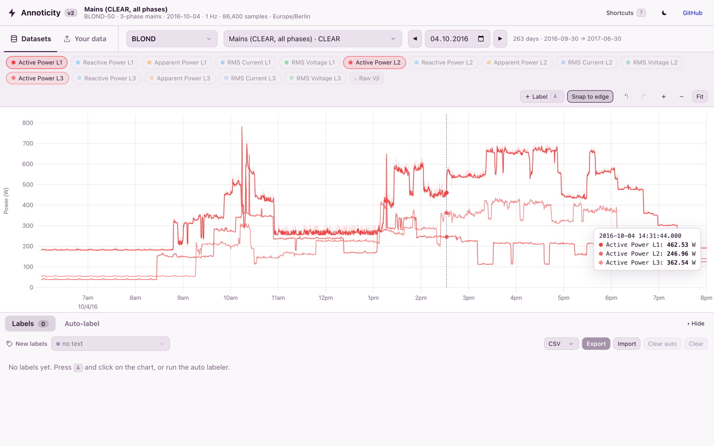

# Annoticity v2

Browse and label electricity datasets. Version 2 is a rewrite with a **Svelte** frontend and a **Node.js** backend.
The original Django version lives on the `annoticitiy_v1` branch.


**Download:** [v2.0.0 offline bundle](https://github.com/voelkerb/annoticity/releases/tag/v2.0.0) (needs Node 20+)
· [v1.0.0 source](https://github.com/voelkerb/annoticity/releases/tag/v1.0.0)

| Auto-labeling (light theme) | Raw voltage and current | BLOND mains, three phases |
| --- | --- | --- |
|  |  |  |

- **Datasets**: pick a dataset, a meter and a day. The server fetches or reads the recording and caches it decoded.
  - **FIRED**: 50 Hz summary data, raw 2 kHz V/I (university server).
  - **BLOND** (BLOND-50 and BLOND-250): 1 Hz summaries per socket and for the mains, raw V/I up to 12.5 kHz (TUM's public FTP server).
  - **REDD**, **UK-DALE**, **ECO**: read from a local copy (see Configuration).
- **Your own data**: drop a CSV (header + time column + numeric columns, parsed in the browser) or a FIRED-style MKV file.
- Wide plot with min/max envelopes (short spikes stay visible). Zooming and panning run locally on the full-resolution data;
  raw V/I at 30 s or less (FIRED, BLOND).
- Y axis fits the visible data; scroll or drag on the axis (or Alt + scroll on the plot) to zoom and pan it, "Auto Y" or double-click to fit again.
- Labels: click to add, drag, rename, snap to edge, undo/redo, import/export (CSV, SRT, ASS, JSON).
- Auto-labeling: step detection with refined edges and state clustering, running in a Web Worker.

## Architecture

The browser does almost all the work. It holds a loaded day as `Float32Array`s and handles:

- downsampling, using a block min/max/sum pyramid so even full-day views avoid scanning every sample
- auto-labeling
- CSV parsing
- labels

The server (`server/`) only does what a browser cannot:

- download FIRED files (Basic auth, no CORS) and BLOND files (FTP, HDF5)
- read large local dataset folders (REDD, UK-DALE, ECO) and put irregular samples on a regular grid
- decode WavPack/Matroska with FFmpeg

Each dataset is a provider in `server/src/datasets/`.

It returns the decoded channels in a small binary format: a JSON header followed by float32 channels (see `server/src/binary.js`).

## Run

Requires Node 20+ and `ffmpeg`/`ffprobe` on the server machine.

```bash
npm run setup   # installs root, server and web dependencies
npm run dev     # API on :8787, UI on http://localhost:5173
```

Production: `npm run build && npm start` serves the built UI and the API on http://localhost:8787.

`npm test` runs the server and engine tests, `npm run check` type-checks the frontend.

Offline bundle: `scripts/package-offline.sh v2.x.y` writes `release/annoticity-v2.x.y-offline.zip` (built UI and server
with dependencies; needs only Node 20+, plus ffmpeg for FIRED/MKV). Ready-made bundles are attached to the GitHub releases.

## Configuration (environment)

Set these in `server/.env` or the root `.env` (see `server/.env.example`):

- `PORT` (8787), `ANNOTICITY_CACHE` (decoded-day cache, default `~/.cache/annoticity`)
- `FIRED_URL`, `FIRED_USER`, `FIRED_PASSWORD`; `BLOND_FTP_HOST`, `BLOND_FTP_USER`, `BLOND_FTP_PASSWORD` (defaults work)
- `REDD_PATH`: folder with `house_N/channel_M.dat` and `labels.dat` (directly or in `low_freq/`)
- `UKDALE_PATH`: the UK-DALE `.dat` release (`house_N/channel_M.dat`, `labels.dat`, `mains.dat`)
- `ECO_PATH`: folder with the extracted `NN_sm_csv/NN` and `NN_plugs_csv/NN/MM` day CSVs (optional `labels.json` to name plugs)
- `VITE_API_URL` (frontend, if the API is hosted elsewhere)

Datasets without a configured path show as "not set up" in the picker.

## API

- `GET /api/datasets`: datasets with availability.
- `GET /api/datasets/:ds/meters`: meters with appliance info.
- `GET /api/datasets/:ds/meters/:meter/days`: days with data.
- `GET /api/datasets/:ds/meters/:meter/days/:day`: binary channels of that day (decoded once, then served from the disk cache).
- `GET /api/datasets/:ds/meters/:meter/waveform?start&stop`: binary raw voltage/current, at most 60 s (FIRED, BLOND).
- `POST /api/decode` (multipart `file`): decode an MKV/WAV/FLAC/WavPack upload to binary channels plus embedded SRT labels.

## Notes

A frontend-only build (e.g. GitHub Pages) would need the university server
to send CORS headers or a small proxy, since it requires Basic auth. BLOND is only served over FTP, and the local datasets need a server anyway.
